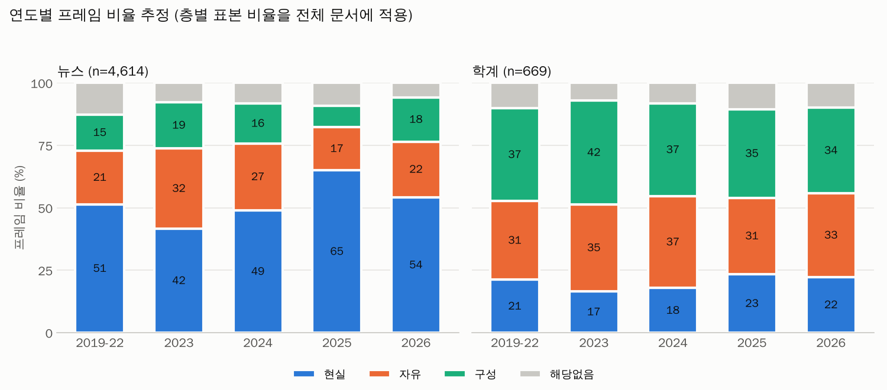

> 통합 원고 초안 v1. 서론은 이번에 새로 쓴 초안이며 나머지 절은 각 초안을 합친 것이다. `[확인]` 표시는 저자가 결정하거나 원문을 확인해야 하는 곳이다. 표·그림 번호와 절 번호는 투고본에서 다시 매긴다.

# 초록

본 연구는 2019년 OECD AI 원칙 채택 이후 2026년 9월까지 한국 언론과 학계가 AI 글로벌 거버넌스를 어떻게 다루었는지를 비교하였다. 전국일간지 11개의 기사 4,631건과 KCI 등재지·등재후보지 논문 669편을 프레임 중립적 기준으로 선별한 뒤, 학술논문에 LDA 토픽모형(K=7)을 추정하고 이를 뉴스에 투영하였다. 토픽별 층화 표본 180건을 국제정치 이론의 세 전통(현실주의, 자유주의, 구성주의)에 비추어 코딩하여 토픽을 프레임으로 해석하고 층 크기로 가중해 프레임 비중을 추정하였다. 분석 결과 뉴스의 78.7%가 국가 전략·미중 경쟁 토픽에 속했고 그 안에서 반도체 수출통제, 군사·전쟁 AI, 정상 외교, 딥시크·중국 오픈소스가 두드러졌으며, 학계는 데이터·개인정보, EU 입법, 윤리·국제규범, 저작권 등 법·제도 토픽에 넓게 분포하였다. 현실주의 프레임의 비중은 뉴스 54%, 학계 21%였고 이 격차는 모든 연도와 코더, 토픽 수, 코퍼스 범위에서 유지되었다. 학계는 자유주의(33%)와 구성주의(36%)로 나뉘었으며 연도에 따른 변화가 작았고, 뉴스의 연도별 변화는 딥시크, 수출통제, 정상회담 같은 사건에 따른 토픽 구성의 변화와 겹쳤다. 이 연구는 한국의 AI 글로벌 거버넌스 담론을 같은 주제 축 위에서 언론의 지정학적 경합 프레임과 학계의 제도·규범 프레임으로 구분해 보였다. 다만 프레임 코딩의 독립 일치도(κ 0.51)가 보통 수준이고 층별 표본이 작아 토픽별 대응은 잠정적이다.

**주제어**: AI 거버넌스, 토픽모델링, 프레임 분석, 국제정치이론, 언론, 학술논문

# Abstract

This study compares how Korean news media and academia have discussed global AI governance from the adoption of the OECD AI Principles in May 2019 through September 2026. Using a frame-neutral relevance criterion, we selected 4,631 articles from 11 national dailies and 669 papers from KCI-indexed journals. We estimated an LDA topic model (K = 7) on the academic corpus and projected the news corpus onto it, placing both discourses on the same topic axis. A stratified sample of 180 documents across 18 topic strata was coded using the three traditions of international relations theory (realism, liberalism, constructivism), and frame shares were estimated with stratum-size weights. Of the news articles, 78.7% fell into the national-strategy and US-China competition topic, where chip export controls, military AI, summit diplomacy, and Chinese open-source models stood out, whereas academic papers were spread across legal and institutional topics such as data protection, EU legislation, ethics and international norms, and copyright. The realist frame accounted for 54% of news but 21% of academic discourse, a gap that held across years, coders, topic numbers, and corpus definitions. Academic discourse split between liberal (33%) and constructivist (36%) frames with little change over time, while year-to-year change in news coincided with event-driven shifts in topic composition. The findings characterize Korean AI governance discourse as a geopolitical-contestation frame in the media and an institutional-normative frame in academia. Inter-coder agreement on frames was moderate (kappa = 0.51) and strata samples were small, so topic-to-frame mappings are tentative.

**Keywords**: AI governance, topic modeling, framing, international relations theory, news media, academic discourse

# Ⅰ. 서론

## 1. 연구 배경과 목적

인공지능(AI)을 어떻게 규율할 것인가는 기술 정책의 문제를 넘어 국제정치의 문제가 되었다. 2019년 OECD가 AI 원칙을 채택한 뒤 유럽연합은 2024년에 포괄적 AI 규제법을 제정했고, 미국과 중국은 반도체 수출통제와 기술 표준, 군사 활용을 둘러싸고 경쟁하고 있으며, 유엔과 G7 등 다자 무대에서도 AI 규범 논의가 이어졌다. 한국은 2024년 5월 영국과 함께 AI 서울 정상회의를 공동 개최하였고 AI 기본법을 제정하였다 `[확인: 제정·시행 시기]`. 이런 흐름 속에서 한국의 언론과 학계는 AI 글로벌 거버넌스를 서로 같은 방식으로 다루고 있는가. 언론은 사건과 경쟁을 중심으로, 학계는 제도와 규범을 중심으로 다루리라는 짐작은 있으나 이를 같은 기준으로 비교한 연구는 확인하지 못했다 `[확인: 학술DB 직접 검색 필요]`.

본 연구는 2019년 5월부터 2026년 9월까지 한국 전국일간지 기사와 KCI 등재지·등재후보지 논문을 대상으로 AI 글로벌 거버넌스 담론의 주제와 프레임을 비교한다. 먼저 학술논문에서 LDA 토픽모형을 추정하고 이를 뉴스에 투영해 두 담론을 같은 주제 축 위에 놓는다. 이어 토픽별 표본을 국제정치학의 세 이론 전통(현실주의, 자유주의, 구성주의)에 비추어 코딩하여 토픽을 프레임으로 재해석하고 두 담론의 프레임 비중을 추정한다. 연구 문제는 두 가지이다. 언론과 학계는 어떤 정책 주제를 얼마나 다루는가(연구 문제 1), 두 담론은 어떤 이론 프레임으로 구성되며 시기에 따라 어떻게 달라지는가(연구 문제 2).

## 2. 논문의 구성

이하 Ⅱ장에서 AI 거버넌스에 대한 이론과 선행연구를 검토하고, Ⅲ장에서 자료와 분석 방법을, Ⅳ장에서 결과를 제시한다. Ⅴ장에서는 결과를 해석하고 한계와 후속 연구를 논의한다.

# Ⅱ. 이론적 배경

## 1. AI 거버넌스의 국제정치적 성격

인공지능(AI)을 규율하는 국제 규범은 하나의 조약이나 기구가 아니라 여러 기구와 문서가 겹쳐 있는 형태로 발전해 왔다. Raustiala와 Victor(2004)는 부분적으로 겹치는 비위계적 레짐의 집합을 레짐 복합체로 개념화하고, 이런 복합체에서는 한 레짐의 규칙이 인접 레짐의 규칙과 충분히 조율되지 않아 법적 불일치가 생기기 쉽다고 보았다. AI 분야에서도 Cihon, Maas와 Kemp(2020)가 국제 AI 거버넌스를 분절 상태로 둘지 중앙집중할지의 문제를 환경·무역·안보 레짐의 사례에 비추어 논의하며, 당분간은 분절이 이어질 가능성이 높다고 전망하였다. Schmitt(2022)는 이 분절된 지형을 행위자 유형과 기존 거버넌스 구조 내 여부로 분류하고, 국제기구가 예상보다 독립적으로 움직이며 OECD를 중심으로 다중심적 레짐이 형성되고 있다고 보았다. 본 연구가 2019년 OECD AI 원칙 채택 이후를 분석 기간으로 삼는 것은 이러한 레짐 형성의 출발점을 고려한 것이다.

이 지형은 협력만으로 구성되지 않는다. Morse와 Keohane(2014)은 국가, 국제기구, 비국가 행위자가 다자 제도를 이용해 기존 제도의 규칙과 관행에 도전하는 경합적 다자주의를 제시하고, 이를 기존 레짐의 변화를 이해하는 틀로 활용하였다. 이 틀에 따르면 AI 규범은 합의된 원칙의 집합이라기보다 여러 행위자가 서로 다른 기구와 문서를 통해 규칙의 주도권을 다투는 장이다. 따라서 같은 사건도 어떤 행위자에게는 제도 설계의 문제로, 다른 행위자에게는 경쟁과 안보의 문제로 해석될 수 있다. 이것이 본 연구가 언론과 학계의 담론을 단일한 '국제 규범' 담론으로 보지 않고 이론 전통별 프레임으로 구분해 비교하는 이유이다.

## 2. 세 이론 전통과 AI 담론

### 2.1 현실주의: 힘, 경쟁, 안보

현실주의적 시각에서 AI는 국가 간 힘의 분포에 영향을 주는 기술이다. Horowitz(2018)는 AI를 전기나 내연기관처럼 다양한 영역에 퍼지는 촉진 기술로 보고, 그것이 군사력과 국제정치에 미칠 영향과 선발자 이익이 생기는지를 논의하였다. 국내에서도 AI 반도체 공급망과 미국의 수출통제(유인태, 2025), 기술·플랫폼 경쟁과 규제·담론 경쟁, 외교·군비 경쟁의 세 차원에서 본 미중 AI 패권경쟁(김상배, 2025), AI 군사력 경쟁과 군사 규범 경쟁(차정미, 2022), AI·자율무기체계를 중심으로 본 세력 전이(이재준, 2022)가 연구되었다. 이 계열의 담론은 수출통제, 군사 활용, 기술 패권, 산업 육성과 경쟁력 확보를 문제 정의와 처방의 중심에 둔다. 본 연구는 이러한 논거를 현실주의 프레임으로 조작화한다.

### 2.2 자유주의: 제도, 규칙, 협력

자유주의적 시각은 AI 문제를 규칙과 제도의 설계, 조화, 협력으로 풀려는 접근에 초점을 둔다. 국제기구와 다자 협의체가 AI 정책의 조율 장치로 기능한다는 점(Schmitt, 2022)과 분절된 거버넌스를 조정할 제도 설계의 쟁점(Cihon et al., 2020)이 이 시각의 관심사이다. 규제의 역외 확산을 논하는 연구(Bradford, 2020 `[확인]`)도 규제 체계의 설계와 조화라는 관점에서 이 범주와 연결된다. 학계에서 EU AI Act와 각국 입법을 비교하는 법·정책 연구가 많다는 점을 고려하면, 이 프레임은 학계 담론에서 비중이 클 가능성이 있다. 본 연구는 규칙과 제도의 설계·정합·조화·협력·표준을 논거로 하는 담론을 자유주의 프레임으로 분류한다.

### 2.3 구성주의: 규범, 가치, 정당성

구성주의는 규범이 행위자의 정체성과 이익을 구성하며 규범이 생애주기를 거쳐 확산·내면화된다고 본다(Finnemore & Sikkink, 1998). AI 윤리 지침을 검토한 연구들은 투명성, 정의·공정성, 비해악, 책임, 프라이버시의 다섯 원칙으로 지침이 수렴하되 해석과 이행 방식은 크게 갈린다고 보고하였고(Jobin et al., 2019), 지침이 실제 연구와 개발 관행에서 얼마나 구현되는지에 대한 비판적 평가도 있다(Hagendorff, 2020). 중국의 AI 정책과 윤리·규제를 분석한 연구(Roberts et al., 2021)는 규범과 윤리 담론이 국가마다 다른 정치적 맥락에서 만들어짐을 보여 준다. 본 연구는 권리, 윤리, 책임, 가치, 정당성을 논거로 하는 담론을 구성주의 프레임으로 분류한다.

## 3. 뉴스와 학계 담론에 대한 선행연구

AI에 대한 뉴스 프레이밍 연구는 주로 미국 신문을 대상으로 이루어졌다. Chuan, Tsai와 Cho(2019)는 미국 5개 일간지 기사에서 비즈니스와 기술 주제가 주를 이루고, 이익이 위험보다 더 자주 언급되지만 위험은 더 구체적으로 서술된다고 보고하였다. Cools, Van Gorp와 Opgenhaffen(2024)은 1985~2020년 두 신문 기사에 LDA 토픽모델링과 귀납적 프레임 분석을 결합해, 일·예술·교육 주제가 두드러지고 전반적으로 낙관적이며 디스토피아 프레임은 윤리 문제에 주목한다고 하였다. 본 연구도 토픽모델링과 프레임 해석을 결합하지만, 낙관·비관의 가치 프레임이 아니라 국제정치 이론에 기반한 프레임을 쓴다는 점에서 구별된다.

국내 연구는 AI 보도의 발전·위기 가치 프레임과 인간 통제 가능성의 귀인 프레임을 분석하거나(한국언론학보 2024 `[확인: 저자·권호]`), 보도 내용과 이익·손실 프레임을 시기별로 비교하였고(최믿음·조은수, 2024 `[확인: 권호]`), 한국과 미국의 AI 보도 주제를 토픽모델링으로 비교하였다. 이 비교 연구에 따르면 한국 언론은 4차 산업혁명 전략과 플랫폼 구축, 인재 양성을, 미국 언론은 기술 패권 경쟁과 기술의 명암을 상대적으로 많이 다루었다 `[확인: 저자·학술지·연도]`. 이는 한국 언론이 AI를 주로 국내 산업·전략의 문제로 다룬다는 점을 시사하지만, 국제 거버넌스 담론에 한정해 언론과 학계를 비교한 것은 아니다.

## 4. 연구 공백과 연구 문제

정리하면 국제정치이론은 AI 거버넌스를 분절된 레짐 복합체와 규범 경쟁으로 설명해 왔고, 현실주의 계열 연구는 AI를 국가 간 경쟁과 안보의 문제로 다루어 왔으며, 뉴스 프레이밍 연구는 주로 가치 프레임과 주제 구성에 집중해 왔다. 이번 검토에서 한국 언론과 학계의 AI 글로벌 거버넌스 담론을 같은 기간과 같은 주제 축에서 국제정치 이론 프레임으로 비교한 연구는 확인하지 못했다 `[확인: 학술DB 직접 검색 필요]`. 이에 본 연구는 2019년 OECD AI 원칙 이후 한국 언론과 학계의 담론을 같은 토픽 모형 위에서 비교하고, 토픽을 현실주의·자유주의·구성주의 프레임으로 해석하여 다음 연구 문제를 검토한다.

- 연구 문제 1. 한국 언론과 학계는 AI 글로벌 거버넌스와 관련해 어떤 정책 주제를 얼마나 다루는가.
- 연구 문제 2. 두 담론은 어떤 국제정치 이론 프레임으로 구성되며, 그 비중은 시기에 따라 어떻게 달라지는가.

연구 설계 단계에서 설정한 가설은 언론이 지정학(현실주의) 프레임에 치우치고 학계는 제도·규범(자유주의·구성주의) 논의에 머문다는 것이다. 이는 언론이 국가 간 경쟁과 사건 중심의 소재를 부각하고 학계는 규제 체계와 권리·책임 논의를 상대적으로 많이 다룬다는 선행연구의 시사점에 근거한다.

# Ⅲ. 연구 방법

## 1. 연구 설계 개요

본 연구는 2019년 OECD AI 원칙 채택 이후 한국 언론과 학계가 AI 규범·글로벌 거버넌스를 어떻게 다뤄 왔는지를 비교한다. 분석 기간은 2019년 5월 1일부터 2026년 9월 30일까지이다. 연구 질문은 두 가지이다. 첫째, 언론과 학계는 어떤 정책 주제(topic)를 다루는가. 둘째, 그 주제들은 국제정치학의 세 이론 전통(현실주의, 자유주의, 구성주의)에 비추어 어떤 프레임으로 구성되는가. 가설은 언론이 지정학(현실주의) 프레임에 치우치고 학계는 제도·규범(자유주의·구성주의) 논의에 머문다는 것이다.

분석은 동향분석(trend analysis)의 틀에서 텍스트마이닝으로 수행했다. 절차는 (1) 두 코퍼스 수집, (2) 프레임 중립적 관련성 판정으로 코퍼스 확정, (3) 학계 코퍼스에서 LDA 토픽모형 추정 후 언론 코퍼스에 투영, (4) 토픽별 표본에 프레임 코딩을 하여 토픽→프레임을 대응시키고 비율을 추정하는 순서이다. 주제와 프레임을 모두 보기 위해 정책 이슈 토픽을 먼저 도출하고, 이를 이론 틀로 재해석하는 결합 방식을 택했다.

핵심 설계 원칙은 세 가지이다. ① 프레임 어휘(규범, 윤리, 안보, 패권 등)를 검색식에 넣지 않는다. 그렇지 않으면 수집 단계에서 결과를 미리 정하게 된다. ② 두 코퍼스에 같은 검색 논리와 같은 관련성 기준을 쓴다. ③ 주요 선택마다 민감도 분석용 대안 코퍼스를 둔다(기본 코퍼스와 확장 코퍼스).

## 2. 자료 수집

### 2.1 학술논문

학술논문은 한국학술지인용색인(KCI)의 등재지·등재후보지 논문을 대상으로 했다. 도구는 제목 검색 방식이어서, AI 핵심어를 제목에서 찾는 1단계(수집)와 국제적 맥락을 걸러내는 2단계(오프라인)로 나누었다. 1단계 검색어는 인공지능, 생성형 AI, Generative AI, 챗GPT, ChatGPT이며, 파일럿에서 총 건수가 같거나 극소수였던 검색어(생성형 인공지능, 초거대 AI, 파운데이션 모델 등)는 제외했다. 이후 2024년 파일럿에서 AI·Artificial Intelligence 질의가 인공지능 질의와 다른 논문을 가져온다는 것이 확인되어(2024년 117편 누락) 두 검색어로 보충 수집한 뒤 KCI 논문 ID로 병합했다. 두 번의 수집으로 포획-재포획 추정을 하면 병합본이 전체의 약 99.8%를 포함하는 것으로 추정되나, 두 수집이 독립이라는 가정 아래의 값이므로 실제 누락은 더 클 수 있다.

수집한 고유 논문은 19,263편이다. 월 필터(2019-05~2026-09) 후 19,131편, 등재구분(우수등재·등재·등재후보) 후 18,821편이 남았다. 2단계에서 국제적 맥락어(국제기구·미국·중국·EU 등)가 제목·초록·키워드에 있는 논문을 후보로 삼아 2,272편을 얻었고, 이 중 공학·의약학 대분류 225편을 제외한 2,047편을 관련성 판정 대상으로 했다. 영문 초록만 있는 논문은 번역하여 포함했고(123편, 독일어 초록 2편은 Claude가 한국어로 번역), 영문 초록도 없는 3편은 제목과 키워드만 사용했다. `[확인] 국문 초록 번역 방식과 번역 도구 사용 사실을 각주로 둘지`

### 2.2 신문기사

신문기사는 BIGKinds에서 전국일간지 11개(경향신문, 국민일보, 내일신문, 동아일보, 문화일보, 서울신문, 세계일보, 조선일보, 중앙일보, 한겨레, 한국일보)를 대상으로 수집했다. 검색식은 제목에 인공지능, AI, 생성형AI, 챗GPT, ChatGPT 중 하나를 포함하는 기사이며, AIA·AIG·AIIB·조류인플루엔자는 제외했다. 다운로드 건수 한도(20,000건)에 맞춰 기간을 나누어 받았고, 2019-05~2026-09의 모든 월을 확보했다. 고유 기사는 75,720건이며 노이즈·인사·부고·포토 기사를 제거한 뒤 72,489건이 남았다. 여기에 학술논문과 같은 국제적 맥락어 규칙을 제목·본문·키워드·기관에서 적용해 후보 28,657건을 얻었다.

BIGKinds 내보내기 파일의 본문 필드는 앞 200자뿐이고, 키워드 필드는 기사 전체에서 추출한 명사이다. 따라서 뉴스의 텍스트 정보는 제목, 본문 앞 200자, 키워드로 구성된다. 이는 논문(초록 중심)과 텍스트 길이가 다르다는 뜻이며 한계로 기록한다.

## 3. 관련성 판정과 코퍼스 확정

수집된 후보에는 국제 어휘가 단어로만 걸린 문서가 많다. 이를 걸러내기 위해 프레임 중립적 관련성 기준(v2)을 적용했다. 문서가 AI의 정책·규제·거버넌스·전략·경쟁을 주제로 하며 국제적 수준(국제기구·다국가 비교·글로벌 규범 및 경쟁과 연결된 주요국 정책)에 해당하면 관련(R), 그렇지 않으면 비관련(N)으로 판정한다. 외국 한 나라의 국내 적용이나 개별 법리, 비정책 연구(활용·교육·디자인 등)는 N이다. 기준은 연구자의 독립 코딩과 에이전트 코딩을 비교하며 개정해 확정했다.

### 3.1 학술논문

후보 2,047편을 v2 기준으로 판정하고, 판정 근거와 근거 유형을 기록했다. 연구자는 무작위 100편과 불확실(U)로 남은 논문 전부를 직접 판정했다. 최종 관련 논문은 669편(기본 코퍼스)이다. 근거 유형이 국내인 비관련 논문 229편을 더한 898편을 확장 코퍼스로 두고 민감도 분석에 쓴다. 신뢰도는 새로 뽑은 블라인드 100편에서 연구자와 에이전트의 독립 판정을 비교해 구했으며, Cohen's κ(Cohen, 1960)는 0.282(부트스트랩 95% CI 0.145~0.428)이다. 이 값은 협의 전 독립 신뢰도이다. 불일치를 재확인한 뒤의 일치도(κ 0.825)는 에이전트 판정과 근거를 본 뒤의 수정이므로 독립 신뢰도가 아니다. 연구자 수정 판정을 기준으로 한 v2 관련 판정의 정밀도는 31/31, 재현율은 31/39(79.5%, 95% CI 0.66~0.91)이다. 남은 불일치는 모두 연구자가 관련으로 본 국내 법제·기술 논문이었다. `[확인] 독립 κ가 낮다는 점을 본문에 쓸지 부록에 둘지`

### 3.2 신문기사

후보 28,657건 중 연도별 층화 표본 2,500건을 에이전트가 v2 기준(뉴스판)으로 판정하고(관련 365건), 그 결과로 TF-IDF(제목 문자 2~4-gram과 키워드·기관 단어)를 입력으로 하는 로지스틱 회귀 분류기를 학습해 나머지 기사에 적용했다. 5겹 교차검증 성능은 AUC 0.98이고, 임계값 0.5에서 정밀도 0.84, 재현율 0.82, F1 0.83이었다. 에이전트 5개 중 3개는 관련만 기사별로 판단하고 나머지를 비관련으로 일괄 처리했다고 보고했기 때문에, 비관련 판정의 재현율은 별도 검증이 필요했다.

이를 위해 학습에 쓰지 않은 기사 100건(분류기 관련 예측 60건과 관련 확률 0.15 이상의 경계 비관련 예측 40건)을 연구자가 블라인드로 판정했다. 분류기와의 일치율은 64%, κ는 0.211이었고 관련 예측 60건 중 48건(정밀도 0.80)을 연구자도 관련으로 판정했다. 경계 비관련 40건 중 24건은 연구자가 관련으로 보았다. 연구자가 에이전트 판정을 본 뒤 재확인한 결과 정밀도는 0.90, 경계 비관련 중 관련 비율은 14/40(35%)이 되었다. 이 재확인 값은 독립 신뢰도가 아니다. 연구자 판정 100건을 학습 데이터에 더해 분류기를 재학습했고(학습 2,600건), 관련 확률 0.5 이상(사람이 판정한 기사는 그 판정)을 기본 코퍼스 4,631건, 0.3 이상을 확장 코퍼스 5,945건으로 확정했다. 분류기의 재현율은 직접 측정하지 못했으며, 경계 구간에 관련 기사가 약 35% 섞여 있어 기본 코퍼스는 관련 기사를 일부 놓쳤을 가능성이 있다. 이를 확장 코퍼스 민감도 분석으로 점검한다.

최종 코퍼스의 연도별 규모는 비대칭이다. 기본 코퍼스 기준 뉴스는 2019년 53건, 2020년 47건, 2021년 66건, 2022년 52건에서 2023년 711건, 2024년 798건, 2025년 1,225건, 2026년 1,679건으로 늘어난다. 논문은 2019년 12편에서 2025년 199편, 2026년 196편으로 늘어난다. 초기 연도의 표본이 작아 하위 구간 비교는 2019~2022년을 묶어 제시한다. `[확인] 연구계획의 사건 기준 하위 구간 대신 연도 구간을 쓴 이유를 본문에 밝힐지`

## 4. 텍스트 전처리와 토픽모형

### 4.1 전처리

형태소 분석은 Kiwi(kiwipiepy)로 했으며 인공지능, 생성형, 챗GPT를 사용자 사전에 등록했다. 일반명사·고유명사·외국어 토큰 중 길이 2 이상(AI 제외)인 것을 사용했고, 연구·논문·분석·정책 등 범용어와 뉴스 상투어를 불용어로 처리했다. AI와 인공지능 표기는 통일한 뒤 검색어와 같은 이 어휘 자체는 제거했다. 학술논문의 분석 텍스트는 논문명, 저자 키워드, 국문 초록(없으면 번역한 영문 초록)을 합쳤고, 뉴스는 제목, 본문 앞 200자, 키워드를 합쳤다. 학계 코퍼스의 어휘는 5문서 미만 또는 50% 초과 문서에 나타난 단어를 제외해 1,608개이며 문서당 평균 약 124개 토큰이다.

### 4.2 토픽모형

학계 기본 코퍼스(669편)에 LDA(Blei et al., 2003; gensim; passes 30, iterations 200, alpha·eta 자동 추정)를 적용했다. 토픽 수는 K=4~16에서 시드 3개의 평균 c_v 일관성(Röder et al., 2015)으로 비교했다. K=5~9가 0.45~0.46의 고원이었고 K=7이 0.462로 가장 높아 K=7을 선택했다. 시드 간 표준편차가 0.01~0.03이므로 K=6~8 사이의 차이는 우연일 수 있다. 추정된 토픽은 특허·발명자성(29편), 국가 전략·미중 경쟁(186편), EU 입법(91편), 윤리·국제규범(87편), 저작권(86편), 책임·제조물책임(44편), 데이터·개인정보·알고리즘 규제(146편)이다. 토픽 이름은 상위 단어와 대표 논문을 읽고 연구자가 붙였다.

언론 코퍼스는 학계 모형에 투영해(문서별 지배 토픽 할당) 두 코퍼스가 같은 주제 축 위에 놓이게 했다. 투영 결과 뉴스의 78.7%가 국가 전략·미중 경쟁 토픽에 들어갔는데, 이 토픽에는 수출통제·전쟁·정상 외교·산업 육성·거버넌스 담론이 섞여 있었다. 이를 풀기 위해 해당 뉴스 3,643건에 대해 별도 LDA(K=6, 일관성 0.543)를 추정해 반도체 수출통제, 군사·전쟁 AI, 미중·트럼프 정상 외교, 딥시크·중국 오픈소스, 국가 AI 경쟁력·인재, 국제회의·거버넌스의 여섯 하위 토픽을 얻었다. 학계의 해당 토픽 186편도 같은 모형에 투영해 비교했다. 뉴스 토픽 T0(특허, 17건)은 표본이 너무 작아 프레임 분석에서 제외했다. 토픽 수 민감도는 K=5~9에서 확인했다. K=7과의 문서 분할 일치도(NMI)는 학계 0.57~0.81(K=8이 가장 가깝다)이며, 구조 변화는 K=8에서 데이터·개인정보 토픽이 둘로 나뉘고 K=6에서 특허 토픽이 데이터·개인정보 토픽에 합쳐지는 정도였다. 연도별 현실 프레임 비율의 패턴(뉴스 2025년 최고, 학계 평탄)은 모든 K에서 유지되었다(부록). 다만 전체 프레임 비율은 층 가중 추정 특성상 K에 거의 변하지 않으므로 토픽 구조의 안정성이 K 민감도의 주된 근거이다.

## 5. 프레임 코딩

### 5.1 조작적 정의

프레임은 Entman(1993)의 구성요소(문제 정의, 인과 귀속, 처방)에 따라 문서의 핵심 논거로 판단한다. 처방을 정당화하는 논거를 먼저 보고, 없으면 문제 정의를 본다. 세 이론에 대응하는 범주는 다음과 같다. 현실주의는 국가의 힘·경쟁력·안보·자립(수출통제, 군사 역량, 산업 육성과 경쟁력, AI 주권)을 논거로 하는 문서이다. 자유주의는 규칙과 제도의 설계·정합·조화·협력·표준(규제 체계 설계, 입법 비교, 다자 협의체)을 논거로 하는 문서이다. 구성주의는 권리·윤리·책임·가치·정당성(기본권, 책임 귀속, 인간 창작성, 위험 규범)을 논거로 하는 문서이다. 논거나 처방이 없는 현황 소개·시장 소식, 또는 거버넌스와 무관한 이슈는 해당없음으로 둔다.

코퍼스의 큰 부분이 법리 논문이므로, 법리·정책 문서도 이 논거 기준으로 프레임을 배정한다(연구자 결정). 예를 들어 저작권·특허 요건 해석, 책임 귀속, 소비자 보호는 권리와 책임 논거로 보아 구성주의로 두고, 규제 체계 설계와 입법 비교는 자유주의로 둔다. 이는 국제정치이론의 개념을 논거 유형으로 조작화한 것이므로, 법리 문서의 프레임이 이론적 의미에서 현실주의·자유주의·구성주의와 동일하다고 주장하지 않는다.

### 5.2 표본과 코딩 절차

토픽별로 층화 표본을 뽑았다. 층은 학계 토픽 7개, 뉴스 T1 하위 토픽 6개, 뉴스 T2~T6 5개로 총 18개이며 층별 10건, 합계 180건이다. 이 중 60건은 아래의 신뢰도 파일럿에서 연구자와 Claude가 독립 코딩한 문서이고 120건이 본 코딩이다.

파일럿은 30건씩 세 차례 수행했다. 연구자와 Claude(대규모 언어모델)가 서로의 코딩을 보지 않고 독립 코딩한 뒤 불일치를 분석해 기준을 개정했다. 개정 후 두 라운드의 프레임 Cohen's κ는 0.544(95% CI 0.30~0.75)와 0.459(95% CI 0.21~0.70)이며, 60건을 합치면 일치율 65%, κ 0.51이다. `[확인] 첫 라운드 κ 0.041과 기준 개정 과정을 본문에 쓸지, 부록으로 둘지`

120건의 본 코딩은 Claude가 먼저 프레임을 제안하고 연구자가 전체를 검토해 다른 건만 수정했다. 연구자는 21건(17.5%)을 수정했다. 이 120건은 제안을 본 뒤의 판단이므로 독립 신뢰도로 보고하지 않으며 수정률로만 보고한다. 최종 프레임은 파일럿 60건에서는 연구자의 독립 코딩, 본 코딩 120건에서는 검토 후 값이다.

### 5.3 토픽→프레임 대응과 비율 추정

표본에서 같은 프레임이 60% 이상인 층은 그 프레임으로 대응시키고, 그렇지 않으면 혼합으로 둔다. 18개 층 중 9개가 확정되었고 9개가 혼합이었다. 확정 층 중 3개(학계 특허, 뉴스 군사·전쟁 AI, 뉴스 저작권)는 정확히 60%여서 한 건의 변화로 혼합이 될 수 있다.

뉴스와 학계의 프레임 비율은 층 크기로 가중(사후층화)해 추정하며, 신뢰구간은 층 내 표본 재추출 부트스트랩(2,000회)으로 구했다. 연도별 추이는 각 층의 표본 프레임 비율이 연도에 무관하다는 가정 아래 층의 문서 수로 합산해 구했다. 이 가정이 깨질 수 있는 사건 의존 토픽(정상 외교, 전쟁 AI 등)에서 연도별 추정은 방향만 참고해야 한다. 신뢰구간은 층 내 표본 오차만 반영하며 토픽 분류 오류와 가정 위반은 반영하지 않는다.

확장 코퍼스(논문 898편, 뉴스 5,919건)에는 추가분을 같은 모형에 투영하고 같은 층의 표본 프레임 비율을 적용해 비율을 다시 추정했다. 전체 비율과 연도별 패턴은 기본 코퍼스와 같았다(뉴스 현실 54%, 학계 21~22%). 추가분 자체의 프레임은 코딩하지 않았으므로 이 결과는 토픽 구성 면의 민감도이다.

## 6. 인공지능 활용 고지

본 연구의 관련성 판정(학술논문과 신문기사), 국문 초록 번역(독일어 2편), 그리고 프레임 코딩의 1차 제안에 대규모 언어모델(Claude)을 사용했다. 모든 최종 판정은 연구자가 검토했으며, 에이전트 판정과 연구자 판정의 독립 일치도(κ)는 위에 보고한 값이다. 언어모델이 제안한 값을 본 뒤의 연구자 수정은 독립 신뢰도로 보고하지 않는다. `[확인] 학술지 투고 규정의 AI 활용 고지 문구에 맞춰 수정`

## 7. 방법론적 한계

1. 학술논문 수집은 제목에 AI 핵심어가 있는 논문으로 한정되어 제목에 AI 용어가 없는 거버넌스 논문(알고리즘, 디지털 규범 등)을 놓칠 수 있다.
2. 학술논문 관련성 판정의 독립 κ는 0.282이며, 연구자 수정 판정 기준 재현율은 79.5%(95% CI 0.66~0.91)로 국내 법제·기술 논문 일부를 놓친다. 확장 코퍼스로 민감도를 확인한다.
3. 뉴스 분류기의 재현율은 측정하지 못했다. 경계 구간에 관련 기사가 약 35% 섞여 있다. 2019~2022년 뉴스는 연 47~66건으로 적다.
4. 뉴스는 본문 앞 200자와 키워드만 사용하므로 논문(초록)과 텍스트 정보량이 다르다. 학계 모형에 투영한 뉴스 토픽은 어휘 불일치로 일부 오할당될 수 있다.
5. 프레임 코딩의 독립 κ는 0.51(60건)로 보통 수준이다. 본 코딩 120건은 검토 앵커링이 있다. 층별 표본이 10건이라 토픽→프레임 대응과 비율의 신뢰구간이 넓다.
6. 법리 문서의 프레임은 논거 유형을 이론 프레임에 대응시킨 조작적 정의이다. 학계 코퍼스의 약 65%가 규제·법제 논문이라 자유주의·구성주의 비중이 구조적으로 높아질 수 있다.
7. 토픽 수(K=7)는 일관성 고원 구간의 선택이다. K=5~9 민감도에서 토픽 구조는 대체로 유지되나 작은 토픽(특허)은 K에 따라 합쳐지거나 나뉜다.
8. 연도별 추이 추정은 층 내 프레임 비율의 시간 불변을 가정한다.

# Ⅳ. 연구 결과

## 1. 코퍼스 개요

분석 대상은 2019년 5월부터 2026년 9월까지의 학술논문 669편(기본 코퍼스)과 신문기사 4,631건(기본 코퍼스)이다. 두 코퍼스 모두 2023년 이후 급증하였다. 논문은 2019년 12편, 2020년 31편, 2021년 37편, 2022년 38편에서 2023년 51편, 2024년 105편, 2025년 199편, 2026년 196편으로 늘었고, 기사는 2019~2022년 연 47~66건에서 2023년 711건, 2024년 798건, 2025년 1,225건, 2026년 1,679건으로 늘었다. 2019~2022년 구간은 건수가 적어 하나로 묶어 제시한다.

## 2. 주제 비교

### 2.1 학계 토픽

학계 코퍼스에 K=7 LDA 모형을 추정하였다(표 1). 가장 큰 토픽은 국가 전략·미중 경쟁(186편, 27.8%)이며, 데이터·개인정보·알고리즘 규제(146편, 21.8%)와 EU 입법(91편, 13.6%)이 뒤를 잇는다. 윤리·국제규범(87편, 13.0%), 저작권(86편, 12.9%), 책임·제조물책임(44편, 6.6%), 특허·발명자성(29편, 4.3%)이 나머지를 이룬다. 학계 토픽 7개 가운데 저작권, 책임, 특허를 합하면 약 24%이며, 이 토픽들은 국내 법리 논의의 성격이 강하다.

**표 1. 학계 토픽 (K=7)**

| 토픽 | 문서 수 | 비중 | 주요 단어 |
|---|---|---|---|
| 국가 전략·미중 경쟁 | 186 | 27.8% | 국가, 중국, 전략, 산업, 거버넌스, 안보, 경쟁 |
| 데이터·개인정보·알고리즘 규제 | 146 | 21.8% | 데이터, 정보, 개인, 보호, 규제, 알고리즘, 위험 |
| EU 입법 | 91 | 13.6% | 규제, EU, 기본법, 위험, 입법, 법안 |
| 윤리·국제규범 | 87 | 13.0% | 윤리, 위험, 원칙, 규범, 책임, 투명, 국제 |
| 저작권 | 86 | 12.9% | 저작, 생성형, 학습, 저작물, 공정, 침해 |
| 책임·제조물책임 | 44 | 6.6% | 책임, 제조, 의료, 지침, 의무, 결함 |
| 특허·발명자성 | 29 | 4.3% | 특허, 발명, 판단, 인간, 진보 |

### 2.2 뉴스의 주제 분포

뉴스는 위 학계 모형에 투영하였다. 기사의 78.7%가 국가 전략·미중 경쟁 토픽에 할당되었고, EU 입법 9.2%, 데이터·개인정보 6.2%, 윤리·국제규범 3.9%, 저작권 1.2% 순이었다. 책임과 특허 토픽은 각각 0.4%였다. 학계와 뉴스의 토픽 분포 거리(Jensen-Shannon divergence)는 0.156이다. 학계 토픽 가운데 저작권(12.9% 대 1.2%), 윤리·국제규범(13.0% 대 3.9%), 데이터·개인정보(21.8% 대 6.2%)는 뉴스에서 훨씬 작게 나타났다.

다만 이 78.7%에는 학계 모형에서 하나의 토픽으로 합쳐진 이질적 기사가 섞여 있다. 무작위로 읽은 기사 30건에는 반도체 수출통제, 전쟁 AI, 정상 외교, 산업 육성, 국제회의가 함께 들어 있었다. 이를 풀기 위해 해당 기사 3,643건에 별도 LDA(K=6)를 추정하였다(표 2). 반도체 수출통제(17.8%), 군사·전쟁 AI(18.3%), 미중·트럼프 정상 외교(16.4%), 딥시크·중국 오픈소스(16.4%), 국가 AI 경쟁력·인재(17.8%), 국제회의·거버넌스(13.3%)의 여섯 하위 토픽이 비슷한 비중으로 나타났다. 같은 모형에 투영한 학계의 해당 토픽 186편은 65.1%가 국가 AI 경쟁력·인재 하위 토픽에 속하고 군사·전쟁 AI가 20.4%이며, 반도체 수출통제(1.1%)와 정상 외교(1.6%)는 거의 없었다. 즉 학계의 국가 전략 논의는 뉴스의 지정학 소재(수출통제, 정상 외교)보다 국가 경쟁력과 산업 정책 쪽에 놓여 있다.

**표 2. 뉴스 T1 하위 토픽 (K=6, 3,643건)**

| 하위 토픽 | 비중 | 학계 T1(186편) 투영 비중 |
|---|---|---|
| 반도체 수출통제 | 17.8% | 1.1% |
| 군사·전쟁 AI | 18.3% | 20.4% |
| 미중·트럼프 정상 외교 | 16.4% | 1.6% |
| 딥시크·중국 오픈소스 | 16.4% | 4.8% |
| 국가 AI 경쟁력·인재 | 17.8% | 65.1% |
| 국제회의·거버넌스 | 13.3% | 7.0% |

### 2.3 시기별 변화

학계에서는 EU 입법 토픽이 2023~2024년에 가장 컸고(각 19.6%, 21.9%) 2025년에 7.5%로 줄었다. 저작권 토픽은 2019~2022년 4.2%에서 2024년 19.0%로 커졌으며, 데이터·개인정보 토픽은 2025~2026년에 25% 안팎으로 증가했다. 국가 전략·미중 경쟁 토픽은 2019~2022년 32.2%에서 2023~2024년 약 20%로 낮아졌다가 2025~2026년 약 30%로 돌아왔다.

뉴스에서는 국가 전략·미중 경쟁 토픽의 비중이 2019~2022년 68.8%, 2023년 59.5%, 2024년 70.9%에서 2025년 89.2%, 2026년 84.0%로 커졌다. EU 입법 토픽은 2023년 23.3%, 2024년 14.8%에서 2025년 4.5%, 2026년 4.7%로 줄었다. 하위 토픽으로는 2019~2022년에 국가 AI 경쟁력·인재가 44.0%로 가장 컸고(150건 기준), 2025년에는 딥시크·중국 오픈소스가 24.2%로 커졌으며, 2026년에는 정상 외교(29.8%)와 군사·전쟁 AI(26.4%)가 두드러졌다. 이들 토픽은 특정 사건(2025년 딥시크 공개, 2026년 미중 정상회담과 이란전)과 시기가 겹친다.

## 3. 프레임 비교

### 3.1 코딩 신뢰도

프레임 코딩은 핵심 논거를 기준으로 현실주의(국가의 힘·경쟁력·안보), 자유주의(규칙·제도의 설계·조화), 구성주의(권리·윤리·책임·가치), 해당없음으로 분류하였다. 연구자와 Claude가 독립적으로 코딩한 파일럿 60건에서 프레임 Cohen's κ는 0.544(95% CI 0.30~0.75)와 0.459(95% CI 0.21~0.70)였고, 두 라운드를 합하면 일치율 65%, κ 0.51이다. 본 코딩 120건은 Claude 제안을 연구자가 검토해 21건(17.5%)을 수정하였다. 가장 많이 수정된 방향은 구성에서 현실로(7건)였고, 이는 미국 정부·국방부·기업이 관련된 위험·윤리 기사를 연구자가 현실로 본 경우였다. 이 120건의 값은 검토 앵커링이 있으므로 독립 신뢰도로 보고하지 않는다.

### 3.2 토픽별 프레임

층(토픽)별 표본 10건에서 같은 프레임이 60% 이상이면 그 프레임으로 대응시켰다(표 3). 18개 층 중 9개가 대응되었다. 뉴스에서는 군사·전쟁 AI(60%), 국가 AI 경쟁력·인재(70%), 반도체 수출통제(80%), 딥시크·중국 오픈소스(100%)가 현실주의로 대응되었고, 저작권 토픽(60%)은 구성주의로 대응되었다. 학계에서는 EU 입법이 자유주의(70%), 윤리·국제규범과 책임·제조물책임이 구성주의(각 70%), 특허가 구성주의(60%)로 대응되었다. 학계의 국가 전략·미중 경쟁 토픽은 현실주의가 40%뿐이고 해당없음이 30%여서 혼합으로 남았다. 학계에서 국가 전략이라는 이름의 토픽이 지정학 프레임으로 구성된 것은 아니었다.

**표 3. 층별 프레임 비율 (%, 연구자 최종, 층당 n=10)**

| 층 | 현실 | 자유 | 구성 | 해당없음 | 대응 |
|---|---|---|---|---|---|
| 학계 특허 | 10 | 30 | 60 | 0 | 구성 |
| 학계 국가 전략·미중 경쟁 | 40 | 20 | 10 | 30 | 혼합(현실) |
| 학계 EU 입법 | 0 | 70 | 30 | 0 | 자유 |
| 학계 윤리·국제규범 | 10 | 20 | 70 | 0 | 구성 |
| 학계 저작권 | 10 | 30 | 50 | 10 | 혼합(구성) |
| 학계 책임·제조물책임 | 10 | 20 | 70 | 0 | 구성 |
| 학계 데이터·개인정보 | 30 | 40 | 30 | 0 | 혼합(자유) |
| 뉴스 정상 외교 | 40 | 30 | 30 | 0 | 혼합(현실) |
| 뉴스 군사·전쟁 AI | 60 | 20 | 20 | 0 | 현실 |
| 뉴스 국제회의·거버넌스 | 30 | 40 | 10 | 20 | 혼합(자유) |
| 뉴스 국가 AI 경쟁력·인재 | 70 | 0 | 0 | 30 | 현실 |
| 뉴스 반도체 수출통제 | 80 | 20 | 0 | 0 | 현실 |
| 뉴스 딥시크·오픈소스 | 100 | 0 | 0 | 0 | 현실 |
| 뉴스 EU 입법 | 20 | 50 | 30 | 0 | 혼합(자유) |
| 뉴스 윤리·국제규범 | 10 | 50 | 40 | 0 | 혼합(자유) |
| 뉴스 저작권 | 10 | 20 | 60 | 10 | 구성 |
| 뉴스 책임·제조물책임 | 40 | 20 | 40 | 0 | 혼합(구성) |
| 뉴스 데이터·개인정보 | 10 | 40 | 30 | 20 | 혼합(자유) |

주: 60%에 정확히 걸린 대응(학계 특허, 뉴스 군사·전쟁 AI, 뉴스 저작권)은 한 건의 변화로 혼합이 될 수 있다. 뉴스 책임·제조물책임 층은 코퍼스에서 18건뿐이다.

### 3.3 뉴스와 학계의 프레임 비율

층 크기로 가중한 프레임 비율은 뉴스에서 현실주의 54%(95% CI 46~63), 자유주의 23%(15~32), 구성주의 15%(9~22), 해당없음 8%였고, 학계에서 현실주의 21%(11~32), 자유주의 33%(22~45), 구성주의 36%(26~47), 해당없음 10%였다(표 4). 현실주의 비중의 차이는 약 33%p이고 두 신뢰구간은 겹치지 않는다. 학계에서 자유주의와 구성주의를 합하면 69%이며 뉴스에서는 38%이다. Claude 코딩만으로 계산해도 현실주의는 뉴스 53%, 학계 24%로 같은 방향이다. 다만 학계에서 구성주의 비중은 연구자 코딩 36%, Claude 코딩 32%로, 뉴스에서는 15% 대 23%로 코더에 따라 달랐다.

**표 4. 가중 프레임 비율 (%, 괄호는 95% 부트스트랩 CI)**

| 구분 | 현실 | 자유 | 구성 | 해당없음 |
|---|---|---|---|---|
| 뉴스 (연구자 최종) | 54 (46–63) | 23 (15–32) | 15 (9–22) | 8 (3–13) |
| 학계 (연구자 최종) | 21 (11–32) | 33 (22–45) | 36 (26–47) | 10 (3–18) |
| 뉴스 (Claude 코딩만) | 53 (46–61) | 18 (12–24) | 23 (16–30) | 6 (1–10) |
| 학계 (Claude 코딩만) | 24 (14–34) | 39 (29–51) | 32 (23–41) | 4 (0–11) |

### 3.4 연도별 프레임 추정

각 층의 표본 프레임 비율이 연도에 따라 변하지 않는다는 가정 아래 층의 연도별 문서 수로 합산해 연도별 비율을 추정하였다(표 5, 그림 1). 뉴스의 현실주의 비중은 2019~2022년 51%, 2023년 42%, 2024년 49%에서 2025년 65%로 가장 높아졌고 2026년에 54%였다. 학계의 현실주의 비중은 17~23%로 연도에 따라 거의 변하지 않았고 자유주의 31~37%, 구성주의 34~42%도 큰 변화가 없었다. 매년 뉴스와 학계의 현실주의 비중 차이는 25~42%p였고 모든 연도에서 두 신뢰구간이 겹치지 않았다. 뉴스의 연도별 변화는 어떤 토픽이 커졌는지(2025년 수출통제·딥시크, 2026년 정상 외교·군사)에서 비롯된 것이며 같은 토픽 안의 프레임이 변했는지는 이 표본으로 확인할 수 없다.

**표 5. 연도별 프레임 추정 (%, 괄호는 95% CI)**

| 구분 | 연도 | N | 현실 | 자유 | 구성 | 해당없음 |
|---|---|---|---|---|---|---|
| 뉴스 | 2019–22 | 211 | 51 (39–63) | 21 (15–29) | 15 (8–21) | 13 (4–22) |
| 뉴스 | 2023 | 709 | 42 (33–51) | 32 (21–43) | 19 (11–27) | 8 (3–13) |
| 뉴스 | 2024 | 796 | 49 (40–59) | 27 (18–37) | 16 (9–23) | 8 (3–14) |
| 뉴스 | 2025 | 1,223 | 65 (55–74) | 17 (10–26) | 8 (5–12) | 9 (3–16) |
| 뉴스 | 2026 | 1,675 | 54 (43–65) | 22 (13–32) | 18 (9–27) | 6 (2–10) |
| 학계 | 2019–22 | 118 | 21 (10–32) | 31 (20–43) | 37 (28–48) | 10 (3–20) |
| 학계 | 2023 | 51 | 17 (9–25) | 35 (25–45) | 42 (32–52) | 7 (2–13) |
| 학계 | 2024 | 105 | 18 (9–28) | 37 (25–49) | 37 (26–49) | 8 (2–16) |
| 학계 | 2025 | 199 | 23 (11–35) | 31 (19–43) | 35 (25–48) | 11 (3–20) |
| 학계 | 2026 | 196 | 22 (11–34) | 33 (22–46) | 34 (24–46) | 10 (3–18) |

## 4. 민감도 분석

**토픽 수.** K=5~9에서 학계 토픽 구조는 K=7과 대체로 일치하였다(문서 분할 일치도 NMI 0.57~0.81; K=8이 0.81로 가장 가깝다). K=8에서는 데이터·개인정보 토픽이 둘로 나뉘고 K=6에서는 특허 토픽이 데이터·개인정보 토픽에 합쳐졌다. 연도별 현실주의 비중의 패턴(뉴스 2025년 최고 57~62%, 학계 16~24%에서 평탄)은 모든 K에서 유지되었다. 전체 프레임 비율은 층 가중 추정 방식상 K에 거의 변하지 않아 구조 안정성을 주된 근거로 삼았다.

**확장 코퍼스.** 논문 898편과 기사 5,919건(뉴스 T0 제외)에서도 전체 비율은 기본 코퍼스와 같았다(뉴스 현실주의 54%, 학계 21~22%). 이는 확장분에 기본 코퍼스의 층별 프레임 비율을 적용한 결과이며 확장분의 프레임을 직접 코딩하지 않았다.

**코더.** 위 표 4와 같이 연구자 최종 라벨과 Claude 코딩만을 쓴 결과에서 현실주의 격차는 유지되었으나 구성주의·자유주의의 세부 비중은 달랐다.

## 5. 소결

연구 설계 단계에서 세운 가설을 검토하면 다음과 같다. 첫째, 언론이 현실주의 프레임에 치우친다는 가설은 지지된다. 뉴스의 현실주의 비중은 54%로 학계(21%)의 약 2.6배이고, 이 격차는 모든 연도와 두 코더, 토픽 수와 코퍼스 범위를 바꾼 분석에서 유지되었다. 둘째, 학계가 제도·규범 논의에 머문다는 가설은 부분적으로 지지된다. 학계의 자유주의와 구성주의를 합한 비중은 69%이다. 그러나 구성주의만 두드러지는 것은 아니며 자유주의(33%)와 구성주의(36%)로 나뉜다. 또한 학계에서 국가 전략·미중 경쟁이라는 가장 큰 토픽은 지정학 프레임이 우세하지 않았다.

이러한 결과는 법리·정책 문서에 논거 기준으로 붙인 프레임이라는 조작적 정의 위에서 해석해야 한다. 학계 코퍼스의 큰 부분이 규제·법제 논문이므로 자유주의·구성주의 비중이 구조적으로 높게 나올 수 있다. 층별 표본이 10건이어서 개별 토픽의 프레임 대응은 불확실하며, 연도별 추정은 토픽 안 프레임이 변하지 않는다는 가정에 의존한다.

# Ⅴ. 논의 및 결론

## 1. 주요 결과의 요약

본 연구는 2019년 OECD AI 원칙 채택 이후 2026년 9월까지 한국 언론(전국일간지 11개 기사 4,631건)과 학계(KCI 등재지·등재후보지 논문 669편)의 AI 글로벌 거버넌스 담론을 같은 토픽 모형 위에서 비교하고, 토픽을 현실주의·자유주의·구성주의 프레임으로 해석하였다. 결과는 세 가지로 요약된다. 첫째, 주제 구성이 다르다. 뉴스의 78.7%가 국가 전략·미중 경쟁 토픽에 속하고 그 안에서 반도체 수출통제, 군사·전쟁 AI, 정상 외교, 딥시크·중국 오픈소스, 국가 경쟁력, 국제회의가 비슷한 비중을 차지한 반면, 학계는 데이터·개인정보, EU 입법, 윤리·국제규범, 저작권, 책임 등 법·제도 토픽에 넓게 분포하였다. 둘째, 프레임 구성이 다르다. 현실주의 프레임의 비중은 뉴스 54%, 학계 21%였고, 이 격차는 연도, 코더, 토픽 수, 코퍼스 범위를 바꿔도 유지되었다. 셋째, 학계는 자유주의(33%)와 구성주의(36%)로 나뉘어 있으며, 가장 큰 토픽인 국가 전략·미중 경쟁도 지정학 프레임이 우세하지 않았다.

## 2. 해석

### 2.1 언론의 현실주의 편중

뉴스에서 현실주의 비중이 높은 것은 토픽 구성의 결과이다. 현실주의로 대응된 토픽(반도체 수출통제 80%, 딥시크·오픈소스 100%, 국가 AI 경쟁력·인재 70%, 군사·전쟁 AI 60%)이 뉴스의 상당 부분을 차지하고, 윤리·국제규범이나 저작권처럼 구성주의·자유주의로 기울어진 토픽은 뉴스에서 작았다. 연도별 변화도 토픽 구성의 변화와 겹친다. 2025년에 현실주의 비중이 65%로 가장 높았던 해는 딥시크와 반도체 수출통제 토픽이 각각 20%를 넘은 해이고, 2026년에는 미중 정상회담과 이란전과 관련한 토픽이 커졌다. 이는 뉴스 담론이 사건과 소재에 의해 움직이는 성격을 보여 준다. 다만 이 연구는 그 이유(언론의 보도 관행, 뉴스가치, 국제 정세 등)를 검증하지 않았다. 사건 중심의 보도가 국가 간 경쟁을 부각하기 쉽다는 설명은 가설로 남긴다 `[확인: 보도 관행 문헌으로 보강]`.

### 2.2 학계의 분산된 제도·규범 담론

학계는 현실주의가 21%이고 자유주의와 구성주의를 합하면 69%였다. 그러나 가설에서 예상한 것처럼 규범(구성주의)에 집중된 것은 아니었다. 자유주의(규칙·제도의 설계와 조화)와 구성주의(권리·책임·가치)가 거의 같은 비중이었고, 연도에 따른 큰 변화도 없었다. 이는 학계가 AI를 제도 설계와 권리 보호의 문제로 다루는 비중이 일정하게 높다는 뜻이다. 한편 학계에서 국가 전략·미중 경쟁이라는 이름의 토픽(27.8%)은 현실주의가 40%에 그치고 해당없음이 30%였다. 뉴스 하위 토픽으로 투영하면 학계의 이 토픽은 국가 AI 경쟁력·인재(65.1%)에 가깝고 반도체 수출통제(1.1%)와 정상 외교(1.6%)는 거의 없었다. 같은 '국가 전략'이라는 이름 아래에서도 언론은 수출통제와 정상 외교를, 학계는 국가 경쟁력과 산업 정책을 다룬다는 점이 드러난다.

### 2.3 이론적 함의

Raustiala와 Victor(2004)가 말한 레짐 복합체와 Morse와 Keohane(2014)의 경합적 다자주의는 AI 거버넌스가 여러 제도와 행위자의 경합으로 구성된다고 본다. 본 연구의 결과는 한국에서 이 경합이 언론과 학계에서 서로 다른 면으로 포착된다는 점을 보여 준다. 언론은 경합의 지정학적 측면(수출통제, 정상 외교, 패권)을, 학계는 제도 설계와 권리·책임의 측면을 더 많이 다룬다. 이는 AI 거버넌스를 하나의 '국제 규범' 담론으로 보기보다 이론 전통별 프레임으로 나누어 볼 필요가 있음을 뒷받침한다. 또한 뉴스 프레이밍 연구가 주로 낙관·비관의 가치 프레임에 집중해 온 것(Chuan et al., 2019; Cools et al., 2024)과 달리, 토픽 모형과 국제정치 이론 프레임을 결합하는 방식이 담론의 이론적 구성을 비교하는 데 쓰일 수 있음을 보였다.

### 2.4 정책 담론에 대한 시사점

이 결과를 정책 담론의 단절로 단정할 수는 없다. 다만 언론에서 크게 다루어진 수출통제와 정상 외교 소재가 학계의 국가 전략 논의에서는 거의 나타나지 않았고, 학계의 법·제도 논의(EU 입법 비교, 개인정보, 책임)는 뉴스에서 훨씬 작게 다뤄졌다는 점은 확인된다. 이는 정책 논의에 필요한 정보가 언론을 통해 전달되는 방식과 학계가 정리하는 쟁점의 방향이 다를 수 있음을 시사한다. 두 담론이 서로 어떻게 영향을 주고받는지(예: 학계 연구가 언론 보도에 인용되는지)는 본 연구의 범위 밖이다 `[확인: 정책적 시사점의 범위를 저자가 조정]`.

## 3. 한계

첫째, 학술논문 수집은 제목에 AI 핵심어가 있는 논문으로 한정되어 있어 제목에 AI 용어가 없는 거버넌스 논문을 놓칠 수 있다. 관련성 판정의 독립 κ는 0.282이며 연구자 수정 판정 기준 재현율은 79.5%(95% CI 0.66~0.91)이다. 뉴스 분류기의 재현율은 측정하지 못했다.

둘째, 프레임은 법리·정책 문서에도 논거 기준으로 붙인 조작적 정의이다. 학계 코퍼스의 약 65%가 규제·법제 논문이어서 자유주의·구성주의 비중이 구조적으로 높게 나올 수 있다. 법리 문서의 프레임이 국제정치 이론의 현실주의·자유주의·구성주의와 개념적으로 같다고 주장하지 않는다.

셋째, 프레임 코딩의 독립 κ는 0.51로 보통 수준이며, 코더에 따라 구성주의와 자유주의 비중이 달랐다(학계 구성주의 36% 대 32%, 뉴스 15% 대 23%). 본 코딩 120건은 검토 앵커링이 있다.

넷째, 층별 표본이 10건이라 토픽별 프레임 대응과 비율의 신뢰구간이 넓고, 60% 경계에 걸린 대응이 있다. 연도별 추정은 토픽 안 프레임이 변하지 않는다는 가정에 의존하므로, 같은 토픽 안에서 프레임이 변했는지는 알 수 없다.

다섯째, 뉴스는 본문 앞 200자와 키워드만 사용했고, 학계 모형에 투영한 뉴스 토픽은 어휘 불일치로 일부 오할당될 수 있다. 토픽 수는 일관성 고원 구간에서 고른 것이며 작은 토픽(특허)은 K에 따라 합쳐지거나 나뉜다.

여섯째, 분석은 전국일간지 11개에 한정되어 방송, 인터넷 매체, 소셜미디어는 포함하지 않았다.

## 4. 후속 연구

첫째, 층별 표본을 늘리거나 서로 독립인 두 코더가 전체 표본을 코딩하여 토픽별 프레임 대응의 불확실성을 줄일 수 있다. 둘째, 뉴스 본문 전체를 사용하고 사설·칼럼과 보도를 구분해 프레임이 장르에 따라 다른지 볼 수 있다. 셋째, 확장 코퍼스에서 추가분의 프레임을 직접 코딩해 본 연구의 확장 코퍼스 분석이 가정한 층 내 균질성을 검증할 수 있다. 넷째, 사건 기준으로 시기를 구분(예: 생성형 AI 확산, EU AI Act 합의·시행, 미중 정상회담)해 사건 전후의 프레임 변화를 볼 수 있다. 다섯째, 방송과 인터넷 매체, 정부 문서와 국회 회의록을 포함해 학계와 언론 사이의 정책 담론 경로를 추적할 수 있다.

## 5. 결론

한국 언론과 학계는 같은 기간 AI 글로벌 거버넌스를 서로 다른 이론적 틀로 다루었다. 언론은 현실주의 프레임이 절반을 넘고 수출통제, 군사, 정상 외교, 기술 경쟁이 주를 이루었으며 그 구성은 사건에 따라 변하였다. 학계는 자유주의와 구성주의로 나뉜 법·제도·권리 논의가 약 70%를 차지하고 연도에 따른 변화가 작았다. 이 격차는 2019~2026년 전 기간에서 유지되었으나 층별 표본이 작고 코더 간 일치도가 보통 수준이어서 개별 토픽의 프레임 대응은 잠정적이다. 그럼에도 본 연구는 한국의 AI 글로벌 거버넌스 담론이 단일한 규범 담론이 아니라 언론의 지정학적 경합 프레임과 학계의 제도·규범 프레임으로 구성되어 있음을 같은 토픽 축 위에서 처음으로 보인다는 점에서 의의가 있다 `[확인: "처음"이라는 표현은 학술DB 직접 검색 후에 사용]`.

# 참고문헌

- 김상배 (2025). 미중 인공지능 패권경쟁과 한국: 국제정치의 전환과 중견국의 국가전략. 『국가전략』, 31(2), 101–132.

- 유인태 (2025). 인공지능과 미·중 전략 경쟁의 국제정치: 글로벌 AI 반도체 공급망과 미국의 경제적 강압을 중심으로. 『국제정치논총』, 65(1), 103–140.

- 이재준 (2022). 미국과 중국의 군사 기술 경쟁과 세력 전이: 인공지능, 자율무기체계 군사 기술을 중심으로. 『한국과 국제정치』, 38(3), 1–35.

- 차정미 (2022). 미중 패권경쟁과 인공지능 군사력 경쟁. 『국가전략』, 28(3), 5–31.

- 최믿음·조은수 (2024). AI 관련 뉴스기사의 보도 프레임 분석. 『문화기술의 융합』. `[확인: 권호·쪽수]`

- Blei, D. M., Ng, A. Y., & Jordan, M. I. (2003). Latent Dirichlet allocation. *Journal of Machine Learning Research*, 3, 993–1022.

- Bradford, A. (2020). *The Brussels effect: How the European Union rules the world*. Oxford University Press.

- Chuan, C.-H., Tsai, W.-H. S., & Cho, S. Y. (2019). Framing artificial intelligence in American newspapers. *Proceedings of the 2019 AAAI/ACM Conference on AI, Ethics, and Society*. `[확인: 쪽수]`

- Cihon, P., Maas, M. M., & Kemp, L. (2020). Fragmentation and the future: Investigating architectures for international AI governance. *Global Policy*. `[확인: 권호·쪽수]`

- Cohen, J. (1960). A coefficient of agreement for nominal scales. *Educational and Psychological Measurement*, 20(1), 37–46.

- Cools, H., Van Gorp, B., & Opgenhaffen, M. (2024). Where exactly between utopia and dystopia? A framing analysis of AI and automation in US newspapers. *Journalism*, 25(1), 3–21. https://doi.org/10.1177/14648849221122647

- Entman, R. M. (1993). Framing: Toward clarification of a fractured paradigm. *Journal of Communication*, 43(4), 51–58.

- Finnemore, M., & Sikkink, K. (1998). International norm dynamics and political change. *International Organization*, 52(4), 887–917.

- Hagendorff, T. (2020). The ethics of AI ethics: An evaluation of guidelines. *Minds and Machines*, 30(1), 99–120. https://doi.org/10.1007/s11023-020-09517-8

- Horowitz, M. C. (2018). Artificial intelligence, international competition, and the balance of power. *Texas National Security Review*, 1(3).

- Jobin, A., Ienca, M., & Vayena, E. (2019). The global landscape of AI ethics guidelines. *Nature Machine Intelligence*, 1, 389–399. https://doi.org/10.1038/s42256-019-0088-2 `[확인: 권]`

- Landis, J. R., & Koch, G. G. (1977). The measurement of observer agreement for categorical data. *Biometrics*, 33(1), 159–174.

- Morse, J. C., & Keohane, R. O. (2014). Contested multilateralism. *Review of International Organizations*, 9(4), 385–412.

- Raustiala, K., & Victor, D. G. (2004). The regime complex for plant genetic resources. *International Organization*, 58(2), 277–309.

- Roberts, H., Cowls, J., Morley, J., Taddeo, M., Wang, V., & Floridi, L. (2021). The Chinese approach to artificial intelligence: An analysis of policy, ethics, and regulation. *AI & Society*, 36(1), 59–77.

- Röder, M., Both, A., & Hinneburg, A. (2015). Exploring the space of topic coherence measures. *Proceedings of WSDM 2015*, 399–408.

- Schmitt, L. (2022). Mapping global AI governance: A nascent regime in a fragmented landscape. *AI and Ethics*, 2(2), 303–314. https://doi.org/10.1007/s43681-021-00083-y